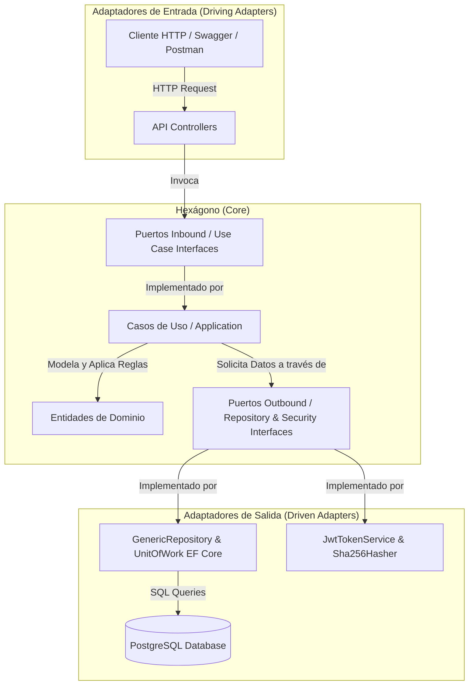

# 🔷 Proyecto Sem9Hex - Arquitectura Hexagonal en .NET 10

Proyecto desarrollado para la **Semana 09**, implementando una **Arquitectura Hexagonal (Puertos y Adaptadores / Ports and Adapters)** en **ASP.NET Core (.NET 10)**. El sistema gestiona un entorno académico universitario y autenticación segura con **Tokens JWT**, **Roles** y **Políticas**, persistido en **PostgreSQL** mediante **Entity Framework Core**.

---

## 📐 1. ¿Qué es la Arquitectura Hexagonal?

La **Arquitectura Hexagonal** (propuesta originalmente por *Alistair Cockburn*) tiene como objetivo principal desacoplar el **núcleo de la aplicación (dominio y casos de uso)** de las tecnologías externas (marcos de trabajo HTTP, bases de datos, librerías criptográficas, interfaces de usuario).

### Principios Fundamentales:
* **Independencia Tecnológica:** El dominio no sabe qué base de datos se usa (PostgreSQL) ni cómo se consumen sus datos (REST API).
* **Inversión de Dependencias (DIP):** El núcleo define **Puertos** (interfaces) y la infraestructura provee **Adaptadores** que las implementan.
* **Alta Testabilidad:** La lógica de negocio puede ser testeada sin levantar servidores web ni bases de datos reales.

---

## 🏛️ 2. Estructura del Proyecto

```
c:\Cnet\tareaSem9/
│
├── tareaSem9.sln                          # Solución principal (.sln)
├── tareaSem9.slnx                         # Solución moderna (.slnx)
├── README.md                              # Documentación del repositorio
│
└── tareaSem9/
    ├── Core/                              # 🔶 NÚCLEO HEXAGONAL (Lógica pura e independiente)
    │   ├── Domain/
    │   │   ├── Entities/                  # Entidades POCO puras de negocio
    │   │   │   ├── Asistencia.cs
    │   │   │   ├── Curso.cs
    │   │   │   ├── Estudiante.cs
    │   │   │   ├── Evaluacione.cs
    │   │   │   ├── Materia.cs
    │   │   │   ├── Matricula.cs
    │   │   │   ├── Profesore.cs
    │   │   │   └── Usuario.cs
    │   │   └── DTOs/                      # Objetos de Transferencia de Datos
    │   │       └── AuthDtos.cs            # (LoginDto, RegisterDto, AuthResponseDto)
    │   │
    │   ├── Ports/                         # 🔌 INTERFACES DE COMUNICACIÓN
    │   │   ├── Inbound/                   # 🚪 Puertos de Entrada (Driving / Casos de Uso)
    │   │   │   ├── IAuthUseCase.cs
    │   │   │   ├── IEstudianteUseCase.cs
    │   │   │   ├── ICursoUseCase.cs
    │   │   │   ├── IMatriculaUseCase.cs
    │   │   │   ├── IEvaluacioneUseCase.cs
    │   │   │   ├── IAsistenciaUseCase.cs
    │   │   │   ├── IMateriaUseCase.cs
    │   │   │   └── IProfesoreUseCase.cs
    │   │   │
    │   │   └── Outbound/                  # 🔌 Puertos de Salida (Driven / Repositorios y Servicios)
    │   │       ├── IGenericRepositoryPort.cs
    │   │       ├── IUnitOfWorkPort.cs
    │   │       ├── ITokenServicePort.cs
    │   │       └── IPasswordHasherPort.cs
    │   │
    │   └── Application/
    │       └── UseCases/                  # ⚙️ Implementación de Casos de Uso
    │           ├── AuthUseCase.cs
    │           ├── EstudianteUseCase.cs
    │           ├── CursoUseCase.cs
    │           ├── MatriculaUseCase.cs
    │           ├── EvaluacioneUseCase.cs
    │           ├── AsistenciaUseCase.cs
    │           ├── MateriaUseCase.cs
    │           └── ProfesoreUseCase.cs
    │
    ├── Adapters/                          # 🔌 ADAPTADORES (Mundo Externo)
    │   ├── Inbound/                       # 🚗 Adaptadores de Entrada (Driving Adapters)
    │   │   └── Controllers/               # Controladores API REST
    │   │       ├── AuthController.cs
    │   │       ├── EstudiantesController.cs
    │   │       ├── CursosController.cs
    │   │       ├── MatriculasController.cs
    │   │       ├── EvaluacionesController.cs
    │   │       ├── AsistenciasController.cs
    │   │       ├── MateriasController.cs
    │   │       └── ProfesoresController.cs
    │   │
    │   └── Outbound/                      # 🛠️ Adaptadores de Salida (Driven Adapters)
    │       ├── Persistence/               # Persistencia de Datos (EF Core & PostgreSQL)
    │       │   ├── ApplicationDbContext.cs
    │       │   ├── GenericRepositoryAdapter.cs
    │       │   └── UnitOfWorkAdapter.cs
    │       └── Security/                  # Seguridad (JWT & Criptografía SHA-256)
    │           ├── JwtTokenServiceAdapter.cs
    │           └── Sha256PasswordHasherAdapter.cs
    │
    ├── Program.cs                         # Configuración y Raíz de Inyección de Dependencias
    ├── appsettings.json                   # Conexión a PostgreSQL y Configuración de JWT
    ├── SWAGGER_GUIA_PRUEBAS.md            # Guía detallada de pruebas Swagger y JWT
    └── tareaSem9.http                     # Archivo de pruebas HTTP directo
```

---

## 🔄 3. Flujo de Datos y Componentes



### 1. Puertos de Entrada (`Inbound Ports`):
Definen **lo que la aplicación puede hacer**. Son contratos como `IEstudianteUseCase` o `IAuthUseCase`. Los controladores llaman a estos puertos y no conocen la implementación interna.

### 2. Puertos de Salida (`Outbound Ports`):
Definen **lo que la aplicación necesita del exterior**. Contratos como `IGenericRepositoryPort<T>`, `IUnitOfWorkPort` o `ITokenServicePort`. La lógica de negocio los utiliza sin saber si se guarda en PostgreSQL, SQL Server o si el token se firma con RSA o HMAC.

### 3. Adaptadores (`Adapters`):
* **Inbound:** Reciben las peticiones HTTP externas, las traducen a llamadas del dominio y devuelven respuestas HTTP JSON.
* **Outbound:** Concretan las interfaces externas usando bibliotecas específicas:
  * `Npgsql.EntityFrameworkCore.PostgreSQL`
  * `Microsoft.AspNetCore.Authentication.JwtBearer`
  * `System.Security.Cryptography`

---

## 🛠️ 4. Tecnologías y Librerías Utilizadas

* **Lenguaje & Framework:** C# / .NET 10.0 (SDK 10.0.301)
* **Arquitectura:** Hexagonal (Ports and Adapters)
* **Base de Datos:** PostgreSQL
* **ORM:** Entity Framework Core 10
* **Seguridad:** JSON Web Tokens (JWT) con claims de Usuario y Roles (`Admin`, `User`)
* **Documentación:** OpenAPI / Swagger UI con autorización integrada mediante `Bearer <token>`

---

## 🚀 5. Instrucciones para Ejecutar Localmente

### Prerrequisitos:
* [.NET 10 SDK](https://dotnet.microsoft.com/) instalado.
* Instancia local de PostgreSQL con la base de datos configurada (o modificar la cadena de conexión en `appsettings.json`).

### Pasos:
1. Clonar el repositorio:
   ```bash
   git clone https://github.com/KlinsmanFlores/Sem9Hex.git
   cd Sem9Hex/tareaSem9
   ```
2. Restaurar dependencias y compilar:
   ```bash
   dotnet restore
   dotnet build
   ```
3. Ejecutar el proyecto:
   ```bash
   dotnet run
   ```
4. Abrir la documentación interactiva en Swagger:
   * Navega a la URL que indica la consola, por ejemplo: `https://localhost:7084/swagger`.

---

## 🧪 6. Guía Rápida de Pruebas

Para un recorrido detallado con ejemplos JSON paso a paso, consulta el archivo:
📄 **[SWAGGER_GUIA_PRUEBAS.md](file:///c:/Cnet/tareaSem9/tareaSem9/SWAGGER_GUIA_PRUEBAS.md)**.

### Resumen del Flujo de Pruebas:
1. **Registro:** `POST /api/Auth/register` (crear usuarios con rol `Admin` y `User`).
2. **Login:** `POST /api/Auth/login` (obtiene el token JWT).
3. **Autorización:** En Swagger, presionar el botón verde **Authorize 🔓** y colocar el token recibido.
4. **Verificación de Políticas y Roles:**
   * `GET /api/Auth/admin`: Solo accesible con rol `Admin` (`200 OK` vs `403 Forbidden`).
   * `GET /api/Auth/admin-politica`: Acceso verificado mediante la política `Administrador`.
   * `GET /api/Auth/user`: Solo accesible con rol `User`.
   * `GET /api/Auth/perfil`: Datos del usuario autenticado.
5. **Módulos Académicos:** CRUD completo para `Estudiantes`, `Cursos`, `Profesores`, `Matrículas`, `Evaluaciones`, `Asistencias` y `Materias`.
